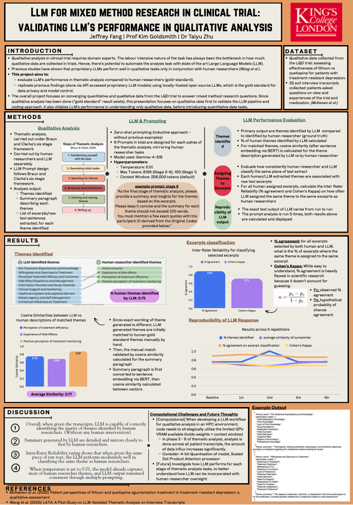

## Academic Projects & Assignments

### Mixed-Methods Clinical Data Analysis using MLLMs

-   **Overview:**

    -   This project evaluated the feasibility of utilizing locally hosted Multimodal Large Language Models (MLLMs) to computationally integrate and jointly analyze qualitative and quantitative clinical trial data.

    -   Using a dataset from the LQD trial for treatment-resistant depression, three mixed-method analytical tasks—Convergence, Explanatory, and Statistical—were applied to the data using an open-source MLLM.

    -   Due to the absence of a definitive human ground truth, an automated "LLM-as-a-Judge" evaluation strategy was implemented to systematically assess the model's analytical performance.

-   **Key Findings:**

    -   The MLLM demonstrated strong overall performance across the mixed-method tasks, achieving high factual consistency and effectively generating functional Python code for quantitative data analysis.

    -   The model successfully analyzed complex logical relationships, effectively bridging qualitative patient narratives with quantitative data trajectories.

    -   While the model showed robust reasoning abilities, a primary limitation observed was its inherent lack of deep, domain-specific clinical knowledge, which required targeted prompting and context to overcome.

-   **My Contribution:**

    -   I designed the three mixed-method research tasks and developed the multi-stage "chain-of-thought" prompting pipelines used to guide the model's analysis.

    -   I created the specific scoring rubrics utilized by the independent "LLM-as-a-Judge" to evaluate the model's factual consistency, coding robustness, and integrative synthesis.

    -   I managed the technical deployment of the models on King's College London's High Performance Cluster (CREATE), utilizing technical strategies like model quantization in 4-bit precision and data batching to successfully overcome Out-Of-Memory (OOM) errors.

------------------------------------------------------------------------

## Extracurricular Activities

### MSc Course Student Representative

-   **Role:** Attend departmental meeting, reflect student opinions on the course.

------------------------------------------------------------------------

## Visual Showcases & Media

### Research Poster: \[LLM for Mixed Method Research in Clinical Trial\]

