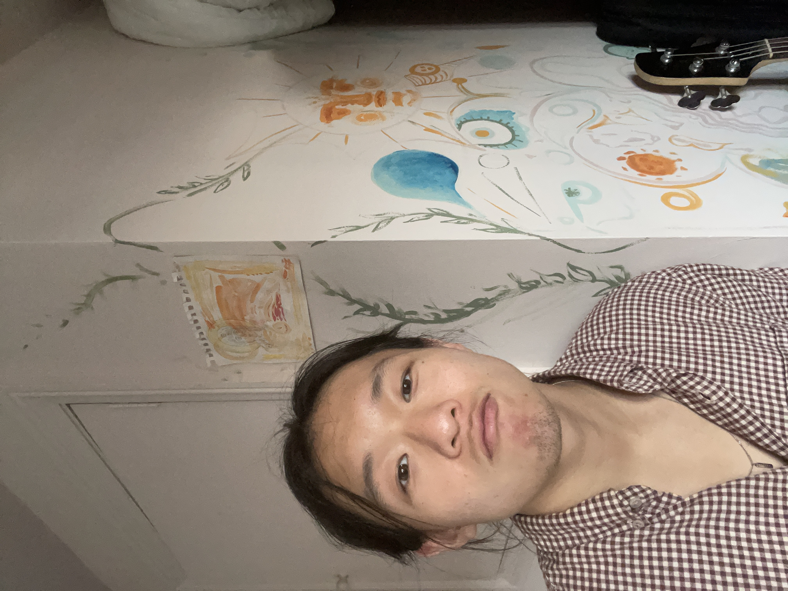

# Introduction

{fig-align="center" width="205"}

## About Myself

-   Early career scientist with experience in both academic research and clinical trial, aiming to combine wet-lab techniques with computational analysis in academic research.

-   Have cycled about everywhere in the world 🚲, and an avid guitarist 🎸.

## Overreaching Education/Career Goals

-   Statistical modelling

-   Machine Learning programming

-   Working with various kinds of data

    -   Bioinformatics, -omics data

    -   Clinical Trial Data

    -   Health Informatics, Electronic Health Record
